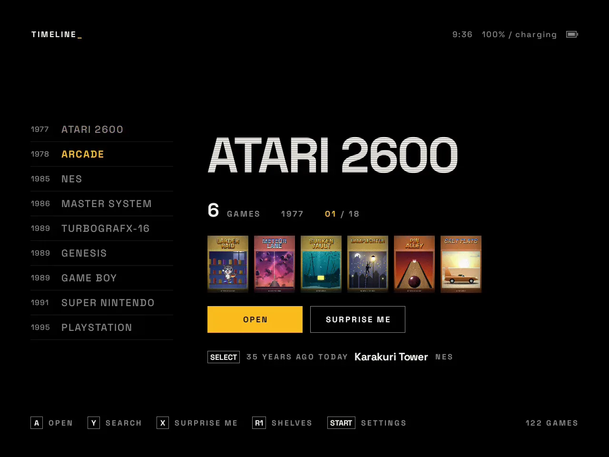
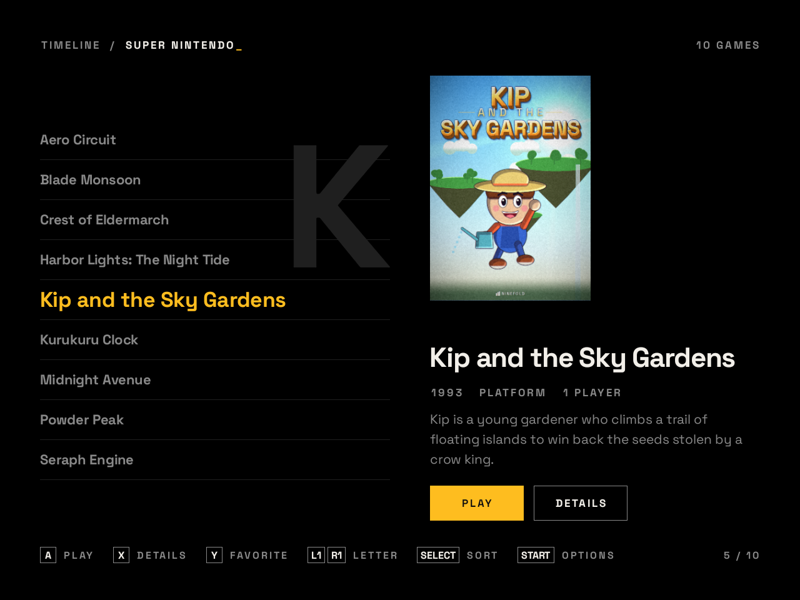
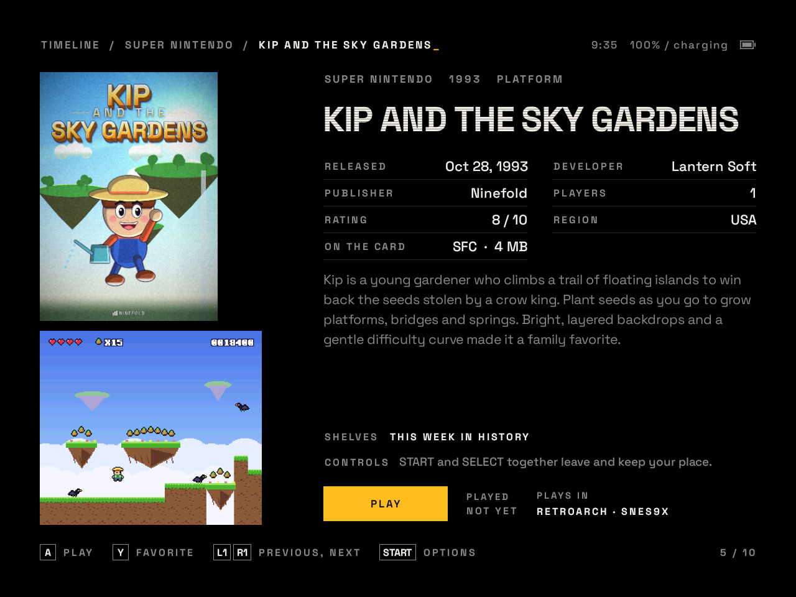
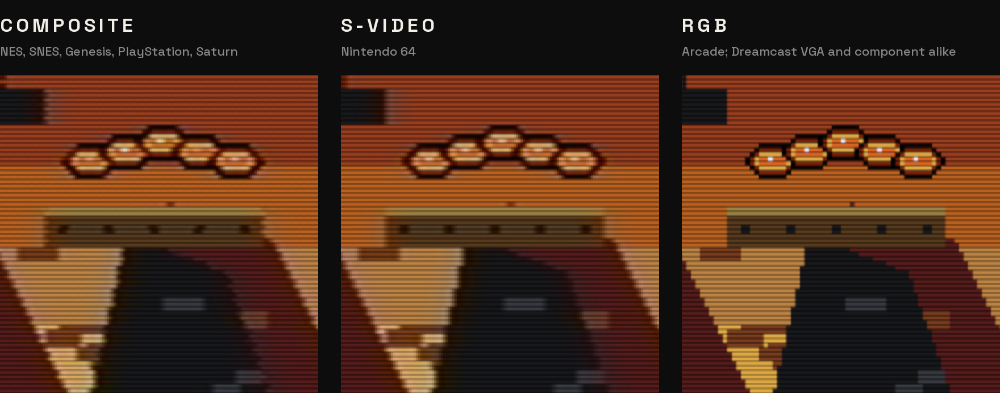
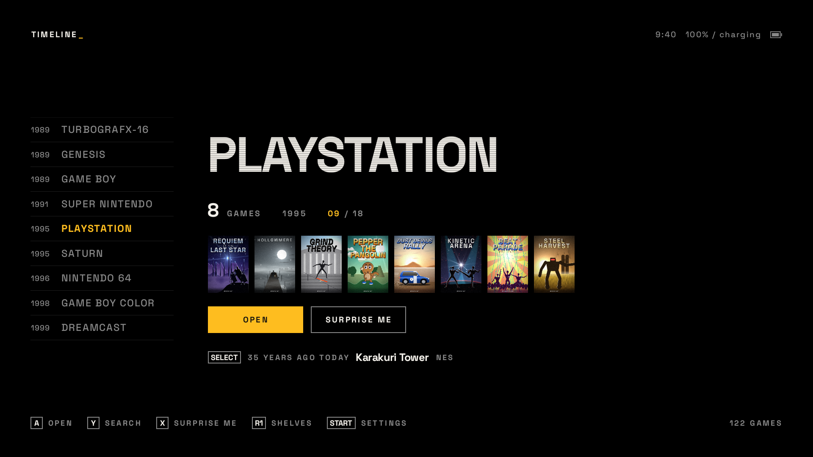
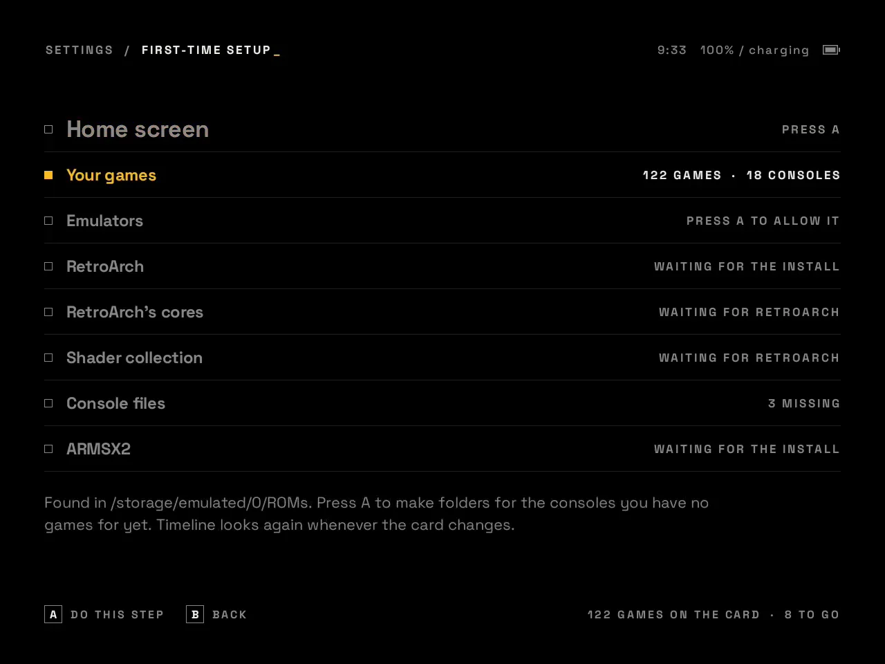
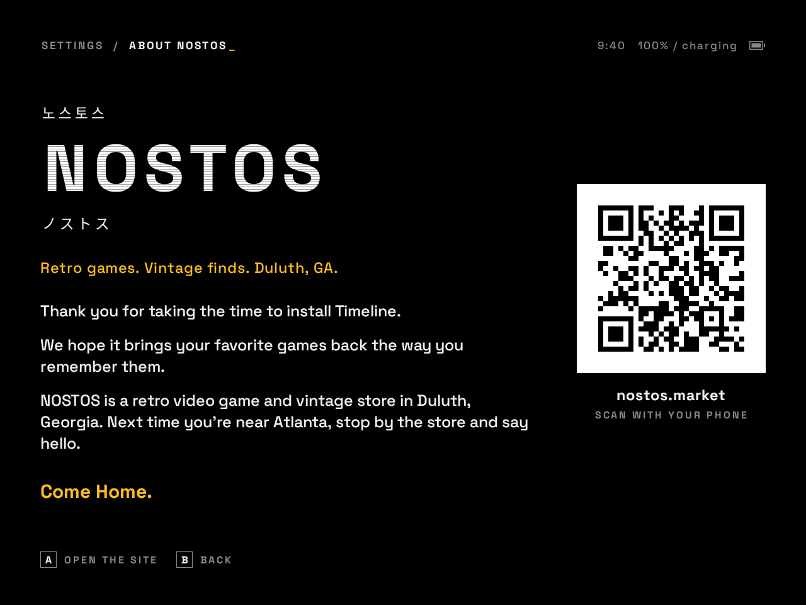

<p align="center">
  <picture>
    <source media="(prefers-color-scheme: dark)" srcset="docs/media/wordmark-dark.png">
    
  </picture>
</p>

<p align="center">
  <b>A home screen for retro handhelds.</b><br>
  Every console on one timeline, set up to look and play the way it did.<br>
  Free and open source, from <a href="https://nostos.market">NOSTOS</a>, a retro video game and vintage store in Duluth, Georgia.
</p>

<p align="center">
  <a href="../../releases/latest">Download</a> &nbsp;·&nbsp;
  <a href="#getting-started">Getting started</a> &nbsp;·&nbsp;
  <a href="docs/picture.md">The picture</a> &nbsp;·&nbsp;
  <a href="docs/lag.md">Input lag</a> &nbsp;·&nbsp;
  <a href="#consoles">Consoles</a>
</p>

<p align="center">
  
</p>

Timeline replaces your handheld's home screen with the consoles you own games for, in the order they came out: the
Atari 2600 in 1977, the Nintendo Entertainment System, the Genesis and the Super Nintendo, on through the PlayStation,
the Dreamcast and the Wii. Pick a console, pick a game, and it opens in the right emulator with the right settings
already in place: the signal that console reached a television by, the scanlines of the tube it was played on, and as
little delay between your thumb and the screen as the hardware allows.

It is free, it collects nothing, and it never includes games or console files. You bring those, from things you own.
Setup walks you through everything else.

<p align="center">
  
  
</p>

## What it does

### Every console, in the order it arrived

One list, oldest to newest, each console with its launch year and its games. Shelves of your own, favorites, games
you've finished, a search, and a Surprise me for when you can't choose. Each game's page carries its cover and a
screenshot, fetched from libretro's thumbnail collection when you ask, and its release date, maker, players and
description when your library's gamelists have them; libraries set up for ES-DE and RetroBat are read as they are.
When a game you own came out on today's date, the home screen says so: *31 years ago today*.

### The picture of the era

<p align="center">
  
</p>

Every console is drawn the way it looked on the screen it was played on in an American home: through the cable it
came with, a television's color and white, and the tube at the other end. The Genesis gets composite, which blends
its dithered stripes into the transparency its artists drew for, with the still rainbow of its waterfalls; the NES and
Super Nintendo get composite timed to their own signal; arcade games get the sharp RGB of a cabinet monitor. Each is
a single choice in Settings, Picture, Signal, and you can change any of them.

- **The tube** is GDV Mini Ultra from RetroArch's shader collection, set as a television showed it: the tube's own
  gamma, scanlines centered on their lines, bright lines blooming into the gaps, nothing clipped. Four other looks are
  there to choose.
- **Each console's own shape and color**: the Master System with its border, the Game Gear's wider pixels, the
  Genesis's measured color levels, and an American set's bluer white.
- **The beam simulator.** On 120 Hz screens, Blur Busters' CRT beam simulator lights each picture for half the time,
  the way a tube did, so moving scenes stay sharp instead of smearing. Black frames are there as the plainer choice.
- **The 3D consoles** at their own resolution, with the PlayStation's dithering and wobble, and the 480-line consoles
  without gaps between their lines, as an interlaced picture looked. A sharper look is one switch away.
- **GameCube, Wii and PlayStation 2** get a 480-line television written for Dolphin and ARMSX2.
- **Game Boy, Game Boy Color, Game Boy Advance, Game Gear and DS** look as their screens did: the Game Boy's green dot
  matrix and smear, the Color's washed-out color, the Advance's darker unlit screen.

[More on the picture, console by console](docs/picture.md).

### Less lag, measured

| | Before | With Timeline |
|---|---|---|
| A button press on the 8 and 16-bit consoles | the next frame | a frame sooner (preemptive frames) |
| A picture leaving RetroArch for the screen | 31.6 ms | 23.2 ms |
| Sound on the cartridge consoles | RetroArch's 128 ms buffer | 48 ms |

Measured on a Retroid Pocket Nova at 120 Hz, still and with a button changing thirty times a second: no late
pictures on any of them. [How it was measured](docs/lag.md).

### Picks up where you left off

Leave a RetroArch game with START and SELECT and the next start puts you back at that exact moment. Your saves and
places are copied to the SD card each time you come back from a game, with earlier versions kept, so a bad save
needn't be the only one.

### Controllers, televisions and screens

In your hands, the handheld's own controls are player one, and each controller you connect takes the next player; in
GameCube and Wii games, the first controller you connect also plays as player one.
Docked to a television, games are set for its refresh rate as they start. Timeline runs on 4:3 handhelds like the
Retroid Pocket Nova and on 16:9 ones, using the whole screen.

<p align="center">
  
</p>

### Made with Retroid devices in mind

On Retroid handhelds, Timeline can also set the fan and power for each console, color the stick lights, hold the
battery at 80% while it rests on the charger, and set up ARMSX2 for PlayStation 2. Each is off until you switch it on
in Settings, Device. It copies PlayStation 2 memory cards along with everything else. On the Retroid Pocket Nova it
corrects the speakers, and on the firmware it was measured on, it offers a measured color calibration.

## Getting started

1. **Download** `Timeline-1.1.1.apk` from [Releases](../../releases/latest) and open it on your handheld. Android
   asks whether your browser or file manager may install apps; allow it. You can switch that off again afterward.
2. **Open Timeline.** It asks for access to your files, so it can find your games, then offers to be your home
   screen. You can say no and open it like any other app.
3. **Follow First-time setup.** It opens by itself and goes one step at a time:

<p align="center">
  
</p>

| Step | What happens |
|---|---|
| Your games | Finds your ROMs folder, or makes one with a folder for every console |
| Emulators | Downloads RetroArch, Dolphin and ARMSX2 from their own developers as your games need them, checks each is signed by them, and hands it to Android to install. melonDS, for DS games on two screens, has a step of its own |
| RetroArch's cores | Opens RetroArch's Core Downloader and names exactly which cores to pick |
| Shader collection | Fetches RetroArch's shaders from libretro and puts them where the looks expect them |
| Console files | Names the files from the consoles themselves that a few systems need, and checks the ones you add |
| Each emulator | Opens each one for the question or two it asks the first time |
| Cover art | Fetches covers and screenshots, if you'd like them |

About fifteen minutes, most of it downloading. [The full walkthrough](docs/setup.md). If something doesn't work,
see [troubleshooting](docs/troubleshooting.md).

## Your games, your files

Timeline does not include games, BIOS files or anything else made by the console makers or publishers, and never
will. Put your own games in the ROMs folder setup makes, one folder per console:

```
ROMs/
  nes/        Your Game (USA).nes
  snes/       Your Game (USA).sfc
  psx/        Your Game (USA).chd
  bios/       scph5501.bin
  ...
```

A few consoles also need a file from the console itself. Setup tells you exactly which, checks each against known
good copies, and [explains how to copy them from consoles you own](docs/console-files.md). The [folder guide](docs/folders.md)
lists every folder name and file type.

## Consoles

| Console | Year | Opens in | Needs a file from the console |
|---|---|---|---|
| Atari 2600 | 1977 | RetroArch (Stella) | no |
| Arcade | 1978 | RetroArch (FinalBurn Neo) | Neo Geo games only |
| NES | 1985 | RetroArch (Nestopia) | no |
| Master System | 1986 | RetroArch (Genesis Plus GX) | no |
| TurboGrafx-16 | 1989 | RetroArch (Beetle PCE) | no |
| Genesis | 1989 | RetroArch (Genesis Plus GX) | no |
| Game Boy | 1989 | RetroArch (Gambatte) | no |
| TurboGrafx-CD | 1989 | RetroArch (Beetle PCE) | yes |
| Super Nintendo | 1991 | RetroArch (Snes9x) | no |
| Game Gear | 1991 | RetroArch (Genesis Plus GX) | no |
| Sega CD | 1992 | RetroArch (Genesis Plus GX) | yes |
| PlayStation | 1995 | RetroArch (SwanStation) | yes |
| Saturn | 1995 | RetroArch (Beetle Saturn) | yes |
| Nintendo 64 | 1996 | RetroArch (Mupen64Plus-Next) | no |
| Game Boy Color | 1998 | RetroArch (Gambatte) | no |
| Dreamcast | 1999 | RetroArch (Flycast) | optional |
| PlayStation 2 | 2000 | ARMSX2 | yes |
| Game Boy Advance | 2001 | RetroArch (mGBA) | no |
| GameCube | 2001 | Dolphin | no |
| Nintendo DS | 2004 | RetroArch (melonDS DS) or melonDS | no |
| Wii | 2006 | Dolphin | no |

ScummVM, DOOM and Quake open in RetroArch too. PSP, Xbox, 3DS, Wii U and PS Vita open in their own emulators if you
install them yourself.

## Devices

Built and tested on a Retroid Pocket Nova (Android 13, 1280 x 960 at 120 Hz), and laid out for 16:9 screens. It
should run on any Android 10 or newer handheld with a 64-bit ARM processor. [What has been tried, and what works on
each](docs/devices.md).

## Known issues

- Games made for 50 Hz European televisions move a little unevenly on 60 and 120 Hz screens. Nothing can fix that
  short of a 50 or 100 Hz screen.
- RetroArch has to download its own cores, so that step of setup happens inside RetroArch, with Timeline naming
  which ones to pick.
- Timeline gives RetroArch a settings file of its own, with saves in RetroArch's `saves` folder sorted by core. Saves
  you made in RetroArch before, kept somewhere else, aren't seen by games started from Timeline until you move them.
- Without Retroid's service, PlayStation 2 games go without the 480-line look, and ARMSX2's autosave is switched on
  by hand; [setup explains how](docs/setup.md#playstation-2).

## Privacy

Timeline has no account and collects nothing. It goes online only for what you start: an emulator from its
developers, RetroArch's shader collection from libretro, or cover art from libretro's thumbnails and the Arcade
Database. [The details](PRIVACY.md).

## Build it yourself

```
git clone https://github.com/nostoshq/timeline
cd timeline
./gradlew assembleDebug
```

JDK 17 and the Android SDK, or Android Studio. Tests: `./gradlew testDebugUnitTest`. See [building and changing
Timeline](CONTRIBUTING.md).

Timeline is finished software, offered as is. This repository isn't watched for issues or pull requests; the source is
yours to read, change and share under the GPL.

## Credits

Timeline stands on the work of the RetroArch, Dolphin, ARMSX2 and melonDS teams, and of everyone who writes and
maintains the cores and shaders they run. In particular: Space Grotesk by Florian Karsten and the Space Grotesk
Project Authors (SIL Open Font License); the CRT beam simulator by Mark Rejhon of Blur Busters and Timothy Lottes
(MIT); GDV Mini Ultra by guest(r), with work by DariusG (GPL-2.0-or-later); the Retroid Pocket Nova display calibration
by pippopapera (MIT); ES-DE's Android launch rules (MIT); pictures from the libretro-thumbnails collection; and for
arcade games, scraping using Arcade Database by motoschifo. Every game shown here is made up for these pictures.
[Full notices](NOTICE.md).

## From NOSTOS



Retro games. Vintage finds. Duluth, GA.

NOSTOS is a retro video game and vintage store in Duluth, Georgia, northeast of Atlanta. We built Timeline for our
own handhelds and wanted everyone to have it. Thank you for giving it a try. If you're ever near Atlanta, stop by
the store and say hello.

[nostos.market](https://nostos.market)

Come Home.

<br clear="right">

---

<sub>Timeline is Copyright (C) 2026 NOSTOS, LLC, free software under the GNU General Public License, version 3 or
later. All names and trademarks belong to their owners and are used only to say which games run where; Timeline is
not affiliated with or endorsed by any of them.</sub>
