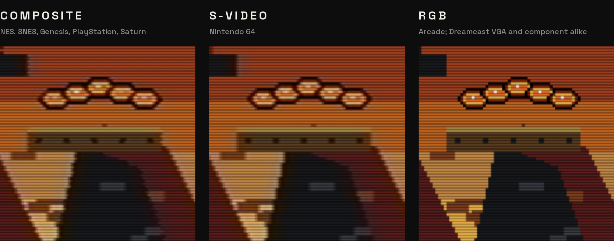

# The picture

Most of these games were made for a television, and the people who drew them knew it. They drew for a picture that
came down a cable, through the electronics of a set, onto the glass of a tube: soft in some places, sharp in others,
lit line by line. Shown raw on a modern panel, the same art can look harsher and flatter than it ever did. Timeline
puts back as much of that chain as a handheld can run, console by console, set to the way each looked in an American
home of its day, and lets you change every part of it.

Everything here is in **Settings, Picture**.

  

## The signal

The first part of the chain is the cable. Most of these consoles came with an RF switch or a composite cable in the
box, and the art of the earlier ones leaned on composite: the Genesis's dithered waterfalls, the Super Nintendo's
hi-res see-through effects, the PlayStation's dithered shading and the Saturn's mesh transparency all blend on it. From
the Nintendo 64 on, nothing in the art needed it, so each console gets the best connection it had. You can switch any
of them in **Settings, Picture, Signal**:

| Console | Signal | Also offered |
|---|---|---|
| Atari 2600 | Composite, through Stella's own filter made for the console | S-video, RGB |
| NES, Super Nintendo, Genesis, TurboGrafx-16 | Composite | S-video, RGB, and RF as it came in the box |
| Saturn, PlayStation | Composite | S-video, RGB |
| Nintendo 64 | S-video, the best an American one had (it had no RGB) | Composite |
| Dreamcast | VGA, which also tells the console the VGA box is in | S-video, composite |
| GameCube, Wii, PlayStation 2 | Component, which sends the picture progressive where the game offers it | S-video, composite |
| Arcade | RGB | Cabinet monitors took RGB directly |

Composite and S-video use the NTSC filter from RetroArch's shader collection at the console's own width, timed to
each console's own signal:

- The NES and Super Nintendo step their color a third of a cycle each line, so their artifacts crawl on a three-line
  pattern. A Super Nintendo hi-res picture, as in Kirby's Dream Land 3, is counted in the console's own pixels, so its
  see-through effects blend as a set blended them.
- A Genesis or Master System line is exactly 228 color cycles, so its artifacts stand still and look the same on
  every line: the rainbow in Sonic's waterfalls.
- The TurboGrafx-16 gets the filter's own PC Engine timing, and its composite palette.

The 3D consoles, which may be drawn larger than the console drew, use a signal pass of Timeline's own that works in
fractions of a scanline, the way a television's bandwidth did.

## The set's color

Between the signal and the tube sits the set's own color: its phosphors, and its white. American sets were sold far
bluer than the 6500 K of the broadcast standard; a 1993 survey of them found an average of about 8000 K. Timeline
shows that by default. **Settings, Picture, Television white** also offers 6500 K and 9300 K, the white of the
Japanese sets these games were made on.

Some consoles get their own color too. The NES's colors are decoded the way an American set's Sony decoder made
them. The Genesis's color levels follow measurements of the console, which are brighter in the darks than an even
ramp.

## The tube

Then the CRT. The default is GDV Mini Ultra from RetroArch's shader collection, set as a tube seen up close, so you
see its pixels and not only its lines:

- the tube's own gamma, so shadows and highlights sit where they did;
- scanlines centered on their lines, with bright lines blooming into the gaps between them;
- the phosphors: a slot mask, red, green and blue slots in staggered rows, as most American sets had;
- a tenth more light and a little glow in bright parts, which give back what the mask takes; no extra saturation, so
  colors are each console's own.

Not every console met a living-room television, and those that didn't get the screen they did meet:

- **Arcade** games get an arcade monitor, seen from arm's length, its slot mask in plain view, at the 9300 K those
  monitors ran at.
- **Dreamcast** on its VGA box gets a PC monitor of 1999: fine, distinct lines at 640 by 480, the red, green and blue
  stripes of an aperture grille, and 9300 K.

**zFast**, **Easymode**, **Lottes Fast** and **CRT-Pi** are lighter or crisper alternatives, and **Off** draws the
picture as the console drew it, scaled by whole numbers so every pixel is the same size. **Color boost** lifts color
past what a set showed, if you want it.

## Motion

A tube lit each part of the picture for a moment and let it fade. Your eye filled in the rest, which is why motion on
a CRT looked sharp. A modern screen holds each picture for the whole frame, and moving things smear.

- **Beam simulator** (on 120 Hz screens): Blur Busters' CRT beam simulator by Mark Rejhon and Timothy Lottes. At
  120 Hz it lights each picture for one refresh and leaves the next dark, its own recommendation for that rate, so
  scrolling backgrounds and fast sprites stay crisp. The picture is dimmer for it, as a tube was; turn the screen's
  brightness up.
- **Black frames**: the same idea done by RetroArch, for consoles where the beam can't run, such as the Nintendo 64
  under OpenGL.
- **Off**.

The Dreamcast gets a steady version of the beam, written for Timeline. When a Dreamcast game loads, the emulator hands
over a new picture only every tenth of a second, and an ordinary beam would blink ten times a second all through the
load. Timeline's version flashes moving pixels exactly as the original does and holds still ones steady at the same
brightness, so loading screens and pauses sit quietly.

## The 3D consoles

The PlayStation, Nintendo 64, Saturn and Dreamcast drew low-resolution 3D. Timeline shows each as it was:

- **PlayStation** at its own resolution, with its 15-bit color and dithering, and the wobble of its corners.
- **Nintendo 64** drawn at four times its detail and averaged back to its own 320 by 240, the nearest thing to the
  smoothing its video chip did.
- **Saturn** at its own resolution, its interlaced hi-res games drawn field by field as a set drew them.
- **Dreamcast** at its own 640 by 480.

A picture of 480 lines on a television cable is drawn without gaps between its lines: those consoles sent their lines
interlaced, and on a set each field filled the other's gaps. Through the Dreamcast's VGA box, each line is drawn as
its own beam, as a monitor showed it.

**3D consoles: sharper than the console** draws the PlayStation and Dreamcast at 960 lines with clean edges and no
wobble, keeps the Nintendo 64's extra detail across, and draws lines on 480-line pictures, like a monitor. A game that
struggles can be run at its own resolution from its page: **Options, Run lighter**. After a sitting with more than 5%
of its pictures late, the page says so and X does the same.

## GameCube, Wii and PlayStation 2

These sent 480 lines: progressive on a component cable, the best they had, and interlaced on composite or S-video.
Timeline writes Dolphin a tube of its own, seen up close: the signal, the set's color and white, the tube's gamma, a
raster of 480 lines whose beams spread with brightness (a dark line leaves the gap below it nearly black, a bright one
nearly fills it), the red, green and blue stripes of an aperture grille, and a little glow. On component, each line
stands apart and the game's picture under it is sharp: Dolphin skips the blending games used against flicker, which
they need only for interlaced output. On S-video and composite, the lines are softer, as a set's interlaced fields
left them, and the games keep that blending. GameCube and Wii are drawn at their own resolution and told which cable
is in. On Retroid devices, PlayStation 2 games get the same tube through ARMSX2, with **Settings, Device, Set up
ARMSX2 for me** switched on.

## The handhelds

Handheld screens were their own thing. **As the console**, the default in **Settings, Picture, Handhelds: screen**:

- **Game Boy**: the green dot-matrix screen, dark dots of ink over a reflector that shows between them, each dot's
  shadow, and the smear of a slow screen, which turned some games' flicker into the see-through it was meant as.
- **Game Boy Color**: its own washed-out colors and pixel shape, with the unlit screen showing through pale pixels.
- **Game Boy Advance**: the original's dark, unlit screen, with its deeper colors, under an LCD grid.
- **Game Gear**: its backlit screen's slow fade, at its own shape: a 4:3 window of pixels a fifth wider than tall.
- **Nintendo DS**: the original DS's color.

**LCD3x**, **LCD grid** and **Off** are plain grids, or none, over the game's colors.

## Shape and size

Every console keeps its own shape, from its own pixels: the NES, Super Nintendo and Genesis at the width a television
showed them, the Master System with the border a set showed around its picture, the Game Gear at 6 by 5 screen pixels
to each of its own on a 4:3 screen. On a 4:3 screen like the Retroid Pocket Nova's, a 4:3 console fills its height.
On a 16:9 screen, it sits in the middle at full height. **Whole-number scaling** keeps every scanline the same height.
